# Rock Climbing Guidebook — climbing.ge

**climbing.ge** is a Georgian rock climbing guidebook covering outdoor sport climbing, mountaineering, ice climbing, bouldering, and indoor facilities.

---

## Table of Contents

- [Overview](#overview)
- [Frontend Pages](#frontend-pages)
- [Backend API](#backend-api)
- [Database Structure](#database-structure)
- [Admin Panel](#admin-panel)

---

## Overview

**Subdomain:** `climbing.ge`  
**Root Component:** `resources/js/components/guide/GuideMainComponent.vue` (IndexComponent)  
**Router:** `resources/js/routes/SiteRoutes.js`

### Article Categories

| Category | Description |
|---|---|
| `outdoor` | Outdoor sport climbing spots |
| `mount_route` | Mountaineering routes |
| `ice` | Ice climbing |
| `indoor` | Indoor climbing gyms |
| `bouldering` | Bouldering areas |
| `other` | Other climbing-related content |

---

## Frontend Pages

### `IndexPageComponent.vue` — Homepage

Sections:
- Hero swiper (`SwiperComponent`)
- What We Do (`WhatWeDoComponent`)
- Topo map (from `$globalSiteData.data.map`)
- Latest news (`newsCard`, `bigNewsCard`)
- Special/featured articles (`SpecialArticleComponent`)
- Upcoming events (`EventComponent`)
- Other articles (`OtherArticlesComponent`)
- Tech tips (`TechtipsComponent`)
- Gallery (`IndexGalleryComponent`)
- Team members slider
- Products slider (cross-promo from shop)

### List Pages (`pages/lists/`)

Each category has a dedicated list page:
- `OutdoorListComponent.vue` — sport climbing regions
- `MountaineeringListComponent.vue` — mountaineering routes
- `IceListComponent.vue` — ice climbing
- `IndoorListComponent.vue` — indoor gyms
- `EventsListPageComponent.vue` — competitions and events

**Common pattern:**
```html
<h1 class="index_h2">Section Title</h1>
<div class="bar"><i class="fa fa-icon"></i></div>
<h3 class="article_list_short_description">Description</h3>
<!-- cards in .article_card_container -->
```

Features: region filter dropdown, grouped/list view toggle (`ViewControlsComponent`).

### Article Pages (`pages/pages/`)

- `OutdoorPageComponent.vue` — outdoor spot with sectors, routes, images, map
- `MountaineeringPageComponent.vue` — mountaineering route
- `IcePageComponent.vue` — ice climbing
- `IndoorPageComponent.vue` — indoor gym
- `EventPageComponent.vue` — event/competition detail
- `LocalBisnesPageComponent.vue` — local business

All of the above fetch their record in `mounted()` and gate their whole content span — `<metaData>` included — behind `article_loading` (`true` initially, `v-else-if="!article_loading"`), **except `EventPageComponent.vue`**, which used to initialize `article_loading: false` and left `<metaData>` ungated. Since its `event` object starts as `[]`, the very first render evaluated `event.locale_event.title` (`[].locale_event` → `undefined`, `.title` on that throws) before the fetch even started — a real render-crashing bug on every event-page load, not just an analytics artifact. Fixed to match the other five; if you add another page here, copy one of those five, not the old `EventPageComponent.vue` pattern.

### Search

`SerchPageComponent.vue` — searches across articles, products, and films.

---

## Backend API

**File:** `routes/api/get_guide_routes.php`

### Key Public Endpoints

| Method | Path | Description |
|---|---|---|
| GET | `/api/get_article/get_locale_articles/{category}/{lang}` | Articles by category + language |
| GET | `/api/get_article/get_locale_article_on_page/{category}/{lang}/{url_title}` | Full article page data |
| GET | `/api/get_outdoor/get_filtred_outdoor_spots/{lang}/{filter_id}/{published}` | Filtered outdoor spots |
| GET | `/api/get_sector/get_sector_and_routes/{article_id}` | Sectors + routes for climbing spot |
| GET | `/api/get_route/get_route_for_modal/{route_id}` | Route detail |
| GET | `/api/get_mount_route/get_mount_routes_by_maunt/{lang}` | Mountaineering routes grouped by mountain |
| GET | `/api/get_mount/get_locale_mounts/{lang}` | Public mount massifs (`published = 1`), for the mountaineering and summit filters |
| GET | `/api/get_mount/{lang}/{mount_id}` / `/api/get_mount/on_page/{lang}/{mount_route_id}` | One mount massif, only when `published` is 1 or 2 (public by URL) |
| GET | `/api/get_event/get_event_on_site_list/{lang}` | Events list |
| GET | `/api/get_region/get_all_outdoor_regions` | All outdoor regions |
| GET | `/api/get_article/last_news/{lang}` | Latest news |

**Mount massif visibility:** `mounts.published` (0 not public, 1 public, 2 public by URL), set in the admin mount massif form (first field) or by bulk publish. Lists only show 1. A mountaineering route whose massif isn't public still appears in the "other routes" group. `get_mount/get_all_mount` is unfiltered because it feeds the admin article forms.

Full endpoint list in [BACKEND/API.md](BACKEND/API.md#guide--public).

### Area page helpers (October 2026)

All on `OutdoorComponent.vue` (outdoor **and** ice pages) unless noted.

- **Route finder** (`climbing_routes/AreaRouteToolbarComponent.vue`, above the sectors): name search, grade-band chips (≤ 5c+, 6a–6b+, 6c–7a+, 7b+, projects, with counts), "Classics" (rated ≥ 4★ — `reviews_stars`, falling back to the admin `routes.stars`), "Hide climbed", and for logged-in climbers "N of M routes climbed" with a progress bar. The toolbar only edits one reactive `route_tools` object that `SectorAndRoutesTabComponent` **provides**; every `SectorComponent` **injects** it and hides rows with `route_matches()` (`services/guide/routeFilters.js` — grade ranking and bands live there). Ticks come from `set_route_ascent/get_my_route_ascents` (best style wins: onsight > flash > redpoint > toprope) and show as a green ✓ in the row; ratings show as stars next to the name. Sector headings get a copy-link button (`?sector=<id>`, which the page already scrolls to). Ratings in the row are followed by the number of logged ascents, e.g. ★★★★ (12).
- **Current conditions** (`items/AreaConditionsComponent.vue`, `#conditions`): logged-in climbers (guests get the login / sign-up modal, and the form opens after logging in) post a short report in two steps — pick a condition card (icon, name and a one-line explanation), then an optional note whose example matches the chosen condition (500-character counter). Reports are **shown for 4 days only** (`AreaConditionReport::FEED_DAYS`; older rows stay in the table, hidden) — `dry`, `wet`, `crowded`, `hazard`, `closure`, `info`, and on ice pages `ice_good` / `ice_poor` — with an optional note. Latest 3 shown (all on demand), with relative time and the climber's name linking to their profile. `hazard` / `closure` reports also appear as a warning banner above the card while they're shown (`WARNING_DAYS` = 4).
- **Directions** (`items/DirectionsButtonComponent.vue`, also on `ArticleComponent` for indoor gyms): `articles.parking` holds `"lat, lng"` or a Google Maps link, entered in the admin global article form ("Parking / directions", outdoor / ice / indoor). Coordinates become a Google Maps directions link. Migration `2026_10_24_130000_add_parking_to_articles_table.php`.
- **Recently viewed**: the page records itself in `localStorage` (`services/guide/recentlyViewed.js`); the outdoor / ice / indoor / mountaineering lists and the guide home show a "Recently viewed" strip.
- **Favourite heart**: no more `confirm()` / `alert()` popups — adding or removing shows a toast, removing has **Undo**.

**Condition reports API** (`area_condition_reports`, model `Guide\AreaConditionReport`, migration `2026_10_24_100000_create_area_condition_reports_table.php`; `user_id` SET NULL and handled with reviews in `AccountDeletionService`):

| Method | Path | Auth | Notes |
|---|---|---|---|
| GET | `get_area_report/get_area_reports/{article_id}` | public | last 60 days, max 20, `admin_hidden = 0`; user restricted to `id, name, surname, image` |
| POST | `set_area_report/create_area_report/{article_id}` | `auth:sanctum`, `throttle:10,1` | outdoor / ice articles only; one report per climber per area per 10 min |
| DELETE | `set_area_report/del_my_area_report/{report_id}` | `auth:sanctum` | own report only |
| POST | `set_area_report/hide_area_report_admin/{report_id}` | `comment › del` | toggles `admin_hidden` |

### Crag for today (outdoor list)

`items/CragPickerComponent.vue`, collapsed panel under the outdoor list head: pick a grade band, sun preference (any / sunny / shady / shade in the morning / in the afternoon) and "family / kids friendly"; it shows the three areas with the most routes in that band, with the reasons. In summer it pre-selects shade, in winter sun. Data: `GET get_outdoor/get_area_profiles` (`OutdoorController::get_area_profiles`) — per published outdoor area: route counts per band (same bands as the route finder), sun / shade flags from its published sectors, family flag and the longest walking time. **Cached for 1 hour** (`outdoor_area_profiles`); `php artisan cache:forget outdoor_area_profiles` after bulk sector edits if you need it immediately.

`get_filtred_outdoor_spots` / `get_filtred_outdoor_spots_for_gest` now return `[]` for an unknown region id (a stale `?region=` link used to throw "Undefined variable $outdoors").

### Mountaineering route helpers

`items/MountainSafetyComponent.vue`, "Before you go" (`#safety`), full page width under the article and the right menu on `MountaineeringPageComponent.vue`. It holds:
- **Grade in plain words:** the Russian category 1–6, derived from `mount_grade` in either scale (`services/guide/mountainGear.js`); hidden when no grade is set.
- **Emergency card:** one horizontal card in three columns (stacked on phones):
  - **112:** tap to call, a short description, and the 112 Georgia app tip.
  - **What to tell the dispatcher:** where you are, what happened, your number; plus "Copy my coordinates" (browser geolocation → `lat, lon (±m)`, copied to the clipboard) and a no-signal tip.
  - **Share my trip plan:** start, back-by time, team → native share sheet or clipboard. **Logged-in users only:** guests get the login / sign-up modal (`open-register-modal`), and the form appears after logging in.

**Gear checklist** (`items/article/GearChecklistComponent.vue`): "What You Need" always shows the text as written; on **outdoor, ice and mountaineering** articles the same gear also appears as a checklist block under it (`text_fallback: false`, so a text without a list isn't shown twice):
- **Building the list:** the article's own text, composed with the general-info block exactly as `GeneralInfoComponent` does it (before / after / instead), becomes a packing checklist. Each `<li>` (nested lists flattened) or each `<br>`-separated line is an item. Other sentences become small notes that head the items after them ("In winter you also need:").
- **Display:** a progress bar, "N / M packed", "All packed", "Untick all", and "Share list" (☑ / ☐ text for the team chat).
- **Saved ticks:** stored per article in `localStorage` (`cg_gear_check_<article id>`), keyed by a hash of each item's text, so editing the list doesn't shift the ticks.
- **Fallbacks:** text with fewer than 2 items falls back to the normal text block. Mountaineering routes pass `default_gear` (base gear + what the grade's category adds), so a route without its own list still gets a checklist.

### Find a partner (`/partners`)

`pages/PartnersPageComponent.vue`, linked from the header "Rock climbing" menu. **Guests** see who goes where and when, but notes and contacts are only sent to logged-in users (`get_partner_posts` blanks them and sets `has_note` / `has_contact` when `auth('sanctum')` has no user); a banner and the locked cards open the login / quick sign-up modal, and posting a plan does too. Climbers post a trip — start (`climb_date`) and optional end (`end_date`, null = one day, at most `PartnerPost::MAX_TRIP_DAYS` = 30 days), the languages they speak (`languages` JSON, codes from `PartnerPost::LANGUAGES`, max 6; pre-selected with the site language), discipline (`sport`, `boulder`, `multipitch`, `trad`, `ice`, `alpine`, `indoor`), an area (outdoor / ice / indoor article) or free-text place, grade range, note and an optional public contact. Posts are grouped by start day — trips already under way come first under "On a trip now", and cards show the date range, the number of days and a "Happening now" badge — and can be filtered by discipline and by language. Clicking a card opens the post in a modal (`StackModal`: climber, discipline, when / where / grades / languages, note, contact or the locked-note login button, Delete for your own) with **Open the area page** for posts linked to an area; the open post is in the URL (`?post=<id>`), so a shared link opens it. Clicking a climber (on a card or in the post modal) opens their profile in `items/climber/ClimberProfileModalComponent.vue` (follow, "View full profile") instead of leaving the page. Page head: `cg-art-partners` (a rope team on a snow slope). A post stays on the board until its trip is over (`PartnerPost::scopeNotOver`: `COALESCE(end_date, climb_date) >= today`; also used for the open-post limit and the dashboard counters). Migration `2026_10_26_120000_add_end_date_and_languages_to_partner_posts_table.php` adds `end_date` and `languages`. Table `partner_posts` (model `Guide\PartnerPost`, migration `2026_10_24_120000_create_partner_posts_table.php`; `user_id` cascades, `article_id` SET NULL).

| Method | Path | Auth | Notes |
|---|---|---|---|
| GET | `get_partner_post/get_partner_posts` | public | not over yet (incl. ongoing trips), `admin_hidden = 0`, max 100; user restricted to `id, name, surname, image` |
| POST | `set_partner_post/create_partner_post` | `auth:sanctum`, `throttle:10,1` | start today … +6 months, end ≥ start and < 30 days later, languages ⊂ `LANGUAGES`; area **or** place required; max 5 open posts per climber |
| GET | `set_partner_post/get_my_partner_posts` | `auth:sanctum` | ids, so the page can offer Delete |
| DELETE | `set_partner_post/del_my_partner_post/{post_id}` | `auth:sanctum` | own post only |
| POST | `set_partner_post/hide_partner_post_admin/{post_id}` | `comment › del` | toggles `admin_hidden` |

---

## Database Structure

### Full Entity Hierarchy

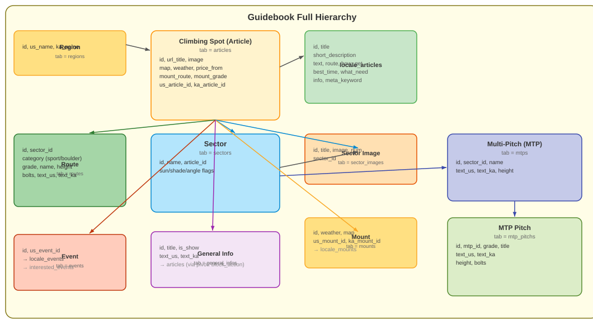

### Articles (Global + Locale)

Articles have two tables:
- `articles` — global data: published status, image, category, url_title
- `locale_articles` — locale version: title, short_description, text content per language

```
articles
├── id, category, url_title, image, published
└── locale_articles (1:many)
    └── article_id, lang, title, short_description, text
```

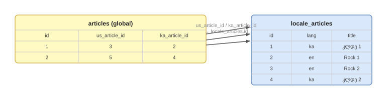

**Created / updated dates on the article page** (`ArticlesService::get_locale_article_in_page`, used by every `get_locale_article_on_page` call): "Created" is the general `articles.created_at` (falls back to the earliest `us`/`ka` `locale_articles.created_at` when the general row has none). "Updated" is the **latest** `updated_at` across the general row and both locale rows — editing only the Georgian text still moves the date. The values are overridden on the returned model only, never saved.

**Indoor gyms** (`category = 'indoor'`):
- `open_time` / `closed_time` (`time`) — working hours shown on `IndoorCardComponent.vue` with a live open/closed hint. `Article::$fillable` used to list `open_timen` (typo), so **editing** a gym never saved `open_time` — fixed October 2026.
- `work_status` (`string`, nullable) — overrides the hours: `temporarily_closed`, `sport_session_closed`, `coming_soon`, `no_info` (`null` = normal hours). Choosing any status clears `open_time`/`closed_time` — in the admin form (inputs disabled) and server-side in `Admin\Guide\ArticleController::normalize_work_status()` (which, like `normalize_mount_grade()`, now also reaches `edit_content()` via `$request->merge(['data' => ...])` — before that, edit-time normalization was silently ignored). Set in the admin form's working-time block. Shown as a colored alert (`guide/items/IndoorWorkStatusAlert.vue`: red / orange / blue, icon, title `guide.article.work_status.*` + explanation `guide.article.work_status_text.*`) on the indoor card and at the top of the gym page; `no_info` gets no alert, only the "No information about working time" line. The card (`IndoorCardComponent.vue`) also shows a colored ribbon on the photo for the three alert statuses, price and hours with icons (seconds trimmed; the hours row is hidden while one of the three alert statuses is set), the whole card is clickable (no separate button), and a live badge — Open now / Closes in N min / Opens in N min / Closed now — computed in minutes (handles closing after midnight), refreshed every minute. Migration `2026_10_18_110000_add_work_status_to_articles_table.php`.
- **Region** — same `article_region` relation outdoor uses (`Article::outdoor_region()`), selected in the add/edit global form and saved by `Admin\Guide\ArticleController::description_img()` for both `outdoor` and `indoor`. The public indoor list (`IndoorListComponent.vue`) gets each gym's region ids (`article_list()` eager-loads `outdoor_region` for `indoor` only) and filters client-side via a region select that lists only regions with at least one gym (`?region=<id>` in the URL).
- **Indoor list filters/sorting** (`IndoorListComponent.vue`, all client-side, kept in the URL query): region (`?region=<id>`, shows a `RegionListHeaderComponent` with the region text), status (`?status=open_now|working` — open right now / hide `temporarily_closed`, `sport_session_closed`, `coming_soon`), sort (`?sort=name|open_now|price`, default newest = API order; closed/coming-soon gyms sort after working ones), and, while all regions are shown, grouping by region (`?group=flat` to turn off; gyms without a region go into an "Other" group). The open-now rule is duplicated from `IndoorCardComponent.vue` — keep them in sync.
- **Coming soon gyms have no page:** the card isn't a link (clicking shows a friendly "page will be available once it opens" notice), and `IndoorPageComponent.vue` shows a placeholder with a link back to the list instead of the article if opened directly.
- **Admin tables** (`user/pages/articles/articleListComponent.vue`): outdoor, indoor and ice get a "Region" text column (`prepare_article_rows()` flattens `outdoor_region` into `region_name`, since data-table cells can't read relations), indoor also a "Working status" column. `Api\Guide\ArticleController::get_category_articles()` eager-loads `outdoor_region:id,us_name` for these three categories. The ice page also gets the Regions management tab (tab id 4) and the region filter on its articles tab, like outdoor.
- **Admin region filter** (`Admin\Guide\OutdoorController::get_filtred_outdoor_spots_for_admin`, `?category=`) only returns articles of the table's category — regions are shared by outdoor, indoor and ice, so without it the outdoor table filtered by region also listed gyms and ice spots.

**Ice articles** have a region too (same `article_region` relation): region select in the add/edit global form, saved/loaded by `Admin\Guide\ArticleController` together with `outdoor` and `indoor`. The admin "ice sectors by region" filter (`SectorController::get_filtred_ice_sectors_for_admin`) already relied on this relation but had no way to set it before.
The public ice list (`IceListComponent.vue`) filters by region client-side like the indoor list: `article_list()` eager-loads `outdoor_region` for `indoor` and `ice`; region select (only regions with at least one spot, `?region=<id>`), region header, and while all regions are shown a By region / Flat toggle (`?group=flat`, spots without a region in "Other"); grid/list view is in the URL too (`?view=list`). Migration `2026_10_19_130000_link_ice_articles_to_regions.php` linked the existing ice spots.

The add form used to keep `region_id` outside the emitted `data` object, so **creating** an outdoor article never saved its region. It now lives in `data`; `LocaleContentControllService::addGlobalArticle()` filters its raw `insertGetId()` to real table columns so form-only keys like `region_id` can't break the insert. (`mount_id` on the add form still has the old problem.)

### General Info

Reusable info blocks (contact details, warnings) that can be embedded in multiple articles.

```
general_infos
└── inserted into article blocks as references
```

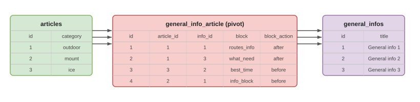

### Outdoor Climbing Spot

An outdoor climbing area is an article with `category = 'outdoor'`.

```
article (outdoor)
├── spot_rocks_images       # Overview rock images for the area
├── sector_local_images     # Sub-area images with multiple sector links
└── sectors (1:many)
    ├── sector_images       # Topo images per sector
    └── routes (1:many)     # Climbing routes
```

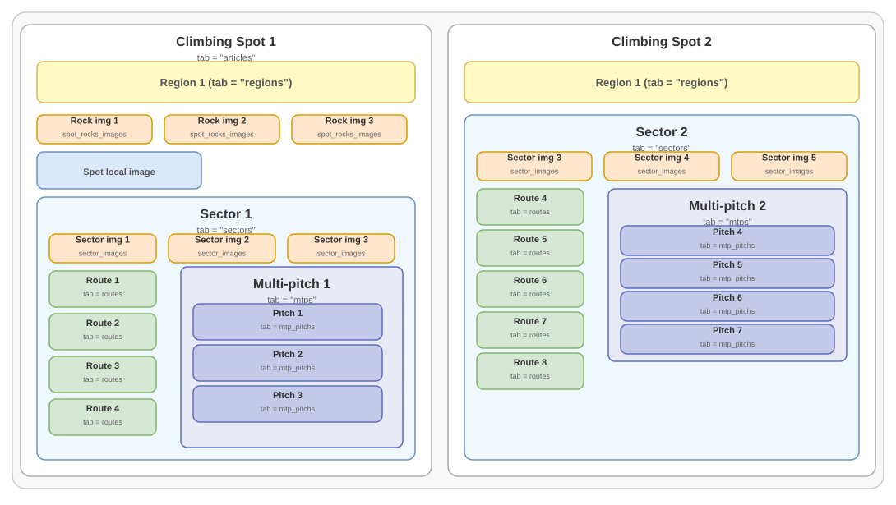  
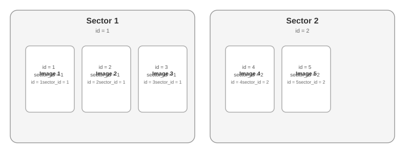  
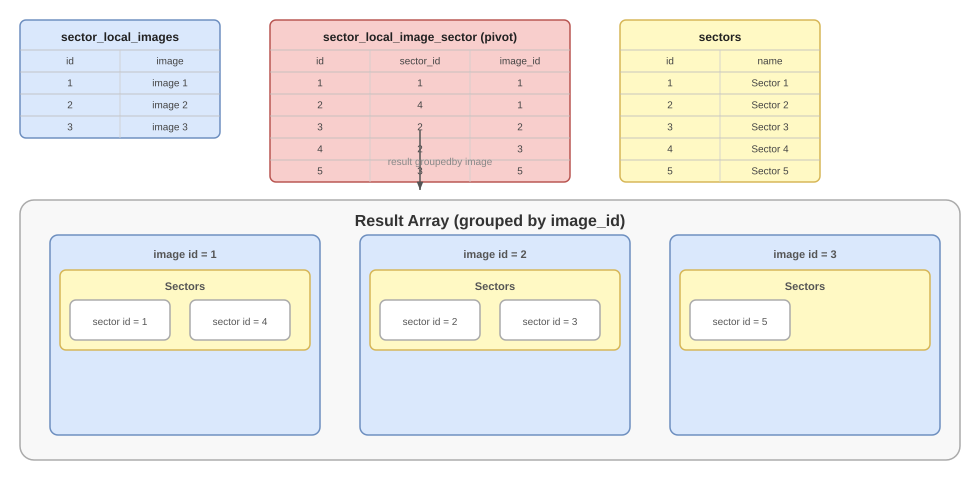

**Route quantity block** (`GET get_route/get_routes_quantity/{article_id}` → `SportClimbingRoutesService::get_routes_quantity`) counts only **published** sectors. Routes, MTPs and pitches have no publish flag of their own, so they're hidden with their sector — same rule as `get_sector_and_routes` and the outdoor list badges (`ArticlesService::get_route_quantity_for_outdoors(..., true)`).

**Sector order** (`sectors.num`) is edited in the admin "Spot Sectors" modal (`ArticleSectorSequenceModalComponent.vue`, opened from the article list). `GET get_sector/get_spot_sectors_data_for_model/{article_id}` returns `{ groups: [{ image, sectors }], ungrouped: [] }` — one group per sector local image, in the same order and membership the public page uses (`SectorController::get_sector_and_routes`: a group's position is decided by its first sector by `num`). Sectors are dragged inside their own group; whole groups move with the up/down buttons; saving flattens all groups (then ungrouped sectors) into `POST set_sector/save_sector_sequence`, which renumbers `num` 1..n. `Sector_local_image::sectors()` / `allSectors()` are ordered by `num` — before October 2026 they weren't, so grouped sectors on the public page ignored the saved order.

### Routes

Sport routes and bouldering share the `routes` table (different `category` value).  
Multi-pitch routes use two tables:

```
mtps (multi-pitch routes)
└── mtp_pitchs (individual pitches, ordered)
```

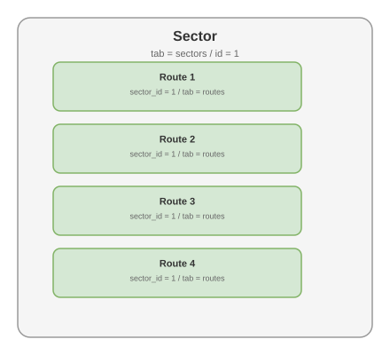  
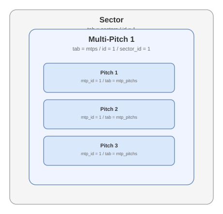

### Mountaineering Routes

```
mount_masives (mountain groups)
└── articles (mount_route category)
    └── locale_articles
```

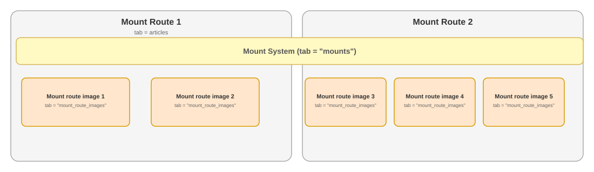

### Gallery

`galleries.image_type` values:

| Value | Used in |
|---|---|
| `header_image` | Section hero images |
| `index_gallery_image` | Homepage gallery |
| `article_image` | Article-specific gallery |

Article images linked via `gallery_image_article` pivot table.

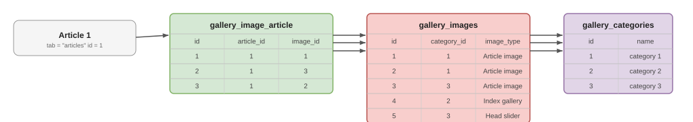

### Comments

Guests and authenticated users can comment on articles.

**Guest flow:** Name + email required → after submission, email matched against registered users → if match found, "Is it your comment?" notification sent to user's dashboard.

**Comment violations:** Any user can report a comment. Admin reviews and decides. Email notification sent.

**Public API field exposure (fixed September 2026):** the commenter/answerer `user` object attached to the public per-article comment feed (`get_article_comments`) is restricted to `id, name, surname, image` — it used to serialize the full `User` model, leaking `email`/`phone_number`/`country`/`city` to any anonymous visitor. The admin-only "all comments" moderation view (which does legitimately need the raw stored `name`/`surname`/`email` columns for guest commenters) is gated behind `auth:sanctum` + `comment › show` permission rather than having its data trimmed. Full writeup: [SECURITY_AND_PITFALLS.md](BACKEND/SECURITY_AND_PITFALLS.md).

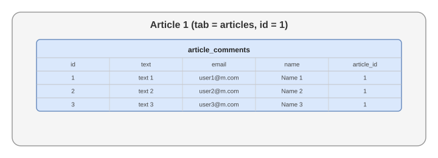  
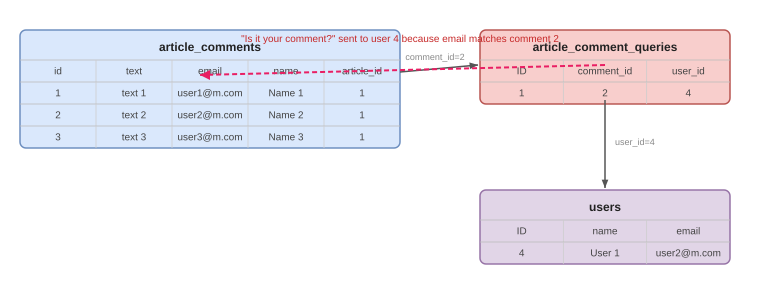  
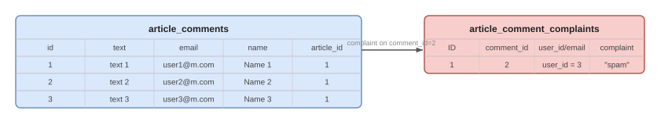  
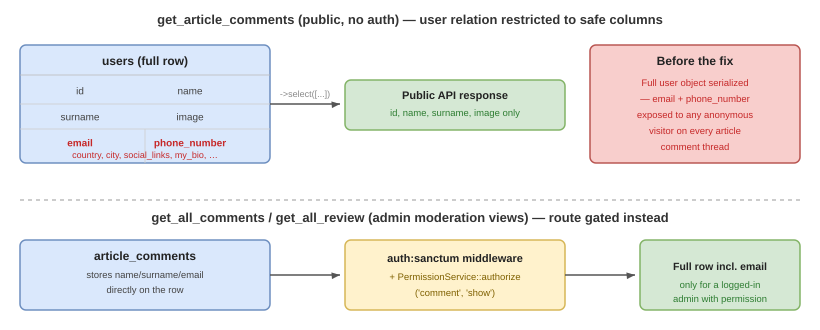

### Route & MTP Reviews

Authenticated climbers can leave a star rating + text review on a sport/bouldering route (`sport_route_reviews`, `Api\Guide\RoutesReitingController`) or a multi-pitch route (`mtp_reviews`, `Api\Guide\MtpReitingController`). Unlike comments, review creation is auth-only (no guest flow) — `create_route_review`/`create_mtp_review` reject a request with no valid Sanctum token.

**Public listings** (shown on the route/MTP page itself, no login required): `GET get_route_review/get_all_route_reviews/{route_id}` and `GET get_mtp_review/get_all_mtp_reviews/{mtp_id}`. Both are rendered by `RouteAllReviewsModal.vue` / `MtpAllReviewsModal.vue`, which link the reviewer's name to their [Climber Profile](CLIMBER_PROFILE.md) (`review.user.id`).

**Admin moderation** (all reviews site-wide, across every route — used to review/hide reviews and handle complaints): the frontend's `all_routes_reviews_page.vue` calls `get_route_review/get_all_review` for route reviews (backed by `Api\Guide\RoutesReitingController::get_all_review`) and `set_mtp_review/get_all_mtp_reviews_admin` for MTP reviews (the properly admin-namespaced `Api\User\Admin\Guide\MtpReitingController`). Both require the `comment › show` permission (reviews share the same moderation permission subject as comments).

**Published/hidden filtering**: only reviews with `published=1, admin_hidden=0` count toward a climber's public `route_reviews_count`/`mtp_reviews_count` and the weighted [points total](CLIMBER_PROFILE.md#the-points-system) shown on their profile — same filter the public listing endpoints apply.

**Data exposure fix (September 2026)**: the public per-route/per-MTP listing endpoints used to attach the *full* `User` row (email, phone number, etc.) to each review — trimmed to `id, name, surname, image` now, matching what the review modals actually render. The site-wide admin "all reviews" endpoints (which do legitimately need more, e.g. email, for moderation) were separately found to be reachable *without any login at all* — now require `auth:sanctum` + the `comment › show` permission. Full writeup, including every other bug found in the same audit: [SECURITY_AND_PITFALLS.md](BACKEND/SECURITY_AND_PITFALLS.md).


### MTP Ascents

Climbers record their multi-pitch ascents — the guide-side counterpart of [summit ascents](SUMMIT.md). Unlike summits there is no GPS check (MTPs have no coordinates), so every ascent is self-reported with a date the climber picks (like a summit **archive** ascent). Login is required, same as MTP reviews.

```
mtp_ascents
├── mtp_id   → mtps (cascade)
├── user_id  → users (nullable, SET NULL — deleted with the account unless the user keeps ascents, see AUTH.md)
├── ascent_date (required, ≤ today), ascent_time (optional)
├── ascent_style  lead | second | alternate (MtpAscent::STYLES, optional)
└── comment, photo (images/mtp_ascents_img/)
```

| Method | Path | Auth | Controller |
|---|---|---|---|
| GET | `get_mtp_ascent/get_mtp_ascents/{mtp_id}` | public | `Api\Guide\MtpAscentController` — user restricted to `id, name, surname, image` |
| POST | `set_mtp_ascent/create_mtp_ascent/{mtp_id}` | `auth:sanctum` + reCAPTCHA (if configured) | `Api\User\Admin\Guide\MtpAscentController` (multipart) |
| GET | `set_mtp_ascent/get_my_mtp_ascents` | `auth:sanctum` | own ascents |
| DELETE | `set_mtp_ascent/del_my_mtp_ascent/{id}` | `auth:sanctum` | own ascent only |
| GET | `set_mtp_ascent/get_all_mtp_ascents_admin` | `mtp › show` | all ascents |
| DELETE | `set_mtp_ascent/del_mtp_ascent_admin/{id}` | `mtp › del` | any ascent |

**Frontend:** the MTP modal (`MTPModalComponent.vue`) shows "Record ascent" and "Ascents (N)" (`ascents_count` from `get_mtp_for_modal`); both open modals in `climbing_routes/items/modals/ascents/` wired through `SectorComponent.vue`, the same way the review modals are. User page `/my_mtp_ascents` (`MyMtpAscentsListPage.vue`, left menu → Favorites) and admin page `/mtp_ascents` (`MtpAscentsAdminPage.vue`, left menu → Guide). MTP ascents don't count toward [climber points](CLIMBER_PROFILE.md#the-points-system) yet.

### Route Ascents (logbook)

Climbers log ticks on sport / bouldering routes (`routes` table) — the single-pitch counterpart of [MTP ascents](#mtp-ascents), same login-only + reCAPTCHA flow and self-reported date.

```
route_ascents
├── route_id  → routes (cascade)
├── user_id   → users (nullable, SET NULL — deleted with the account unless the user keeps ascents, see AUTH.md)
├── ascent_date (required, ≤ today)
├── ascent_style  onsight | flash | redpoint | toprope (RouteAscent::STYLES, required)
├── attempts (optional; forced to 1 server-side for onsight/flash)
├── suggested_grade (optional "grade opinion"; empty = agrees with the topo grade)
└── comment, photo (images/route_ascents_img/)
```

| Method | Path | Auth | Controller |
|---|---|---|---|
| GET | `get_route_ascent/get_route_ascents/{route_id}` | public | `Api\Guide\RouteAscentController` — user restricted to `id, name, surname, image` |
| POST | `set_route_ascent/create_route_ascent/{route_id}` | `auth:sanctum` + reCAPTCHA (if configured) | `Api\User\Admin\Guide\RouteAscentController` (multipart) |
| GET | `set_route_ascent/get_my_route_ascents` | `auth:sanctum` | own ascents (+ `route_name`, `route_grade`, `sector_name`) |
| DELETE | `set_route_ascent/del_my_route_ascent/{id}` | `auth:sanctum` | own ascent only |
| GET | `set_route_ascent/get_all_route_ascents_admin` | `route › show` | all ascents |
| DELETE | `set_route_ascent/del_route_ascent_admin/{id}` | `route › del` | any ascent |

**Frontend:** the route Info modal (`RouteModalComponent.vue`) shows "Log ascent" and "Ascents (N)" (`ascents_count` from `get_route_for_modal`), opening `CreateRouteAscentModal.vue` / `RouteAscentsListModal.vue` (in `climbing_routes/items/modals/ascents/`) through `SectorComponent.vue`. The create modal hides Onsight for boulders and offers grade opinions in the route's own scale (French for sport, V-scale for boulders). The list modal shows per-style counts and the most-suggested grade. User page `/my_route_ascents` (`MyRouteAscentsListPage.vue`, left menu → Favorites) is the climber's logbook with total / hardest send / hardest boulder (toprope excluded); admin page `/route_ascents` (`RouteAscentsAdminPage.vue`, left menu → Guide). Route ascents don't count toward [climber points](CLIMBER_PROFILE.md#the-points-system) yet.

**Logbook stats** (`user/items/ClimbingStatsComponent.vue` on `/my_route_ascents`, computed from the same ascents list): grade pyramid of distinct routes sent clean (onsight / flash / redpoint), ticks per month for the last 12 months, and nine milestone badges (first tick, 10 / 50 routes, 6a / 7a / 8a club, 5 onsights, 5 sectors, 6 active months). After logging a non-toprope ascent, the create modal offers **Share your send** (`services/fun/shareCard.js`) and buzzes the phone briefly.

### Local Businesses

Businesses (guesthouses, shops, tour operators) linked to climbing areas. An article can be related to at most **4** businesses (`Admin\Guide\LocalBisnesController::MAX_RELATIONS_PER_ARTICLE`, returned to the admin relation tabs as `max_relations`; the slot columns follow it). On the article page they're shown by `LocaleBisnesListComponent.vue` as cards in a slider.

```
suport_local_bisneses (global)
├── locale_bisneses (locale: title, description)
├── suport_local_bisnes_images (gallery)
└── article_id (linked climbing spot)
```

Visibility controlled by `published_date` — only show if still within date range.

**Statistics** (Redis, `App\Services\BusinessStatsService`): the guide reports `impression` (card shown on an article page — with the article id — or on the homepage strip), `view` (business modal opened), `click` (a link in the business text) and `photo` (gallery photo opened) to `POST get_bisnes/track/{bisnes_id}` (public, `throttle:120,1`; nothing is sent from the user panel). Keys: `cg:biz:{id}:{metric}` and `…:uniq` (hashes of `Y-m-d` → count; unique = one per hashed IP + user agent per day via a 2-day `SET NX` marker) and `cg:biz:{id}:impression:art` (article id → count). Days older than 400 are trimmed on read. If Redis is down, the same structure goes to the default cache. Admin: chart button in the "Local businesses" table → `BisnesStatsModalComponent.vue` (7 / 30 / 90 / 365 days: totals with unique and all-time, open rate = opened ÷ shown, per-day bars with toggleable metrics, "shown on" table) from `GET set_bisnes/get_bisnes_stats/{id}?days=` (`local_bisnes › show`).

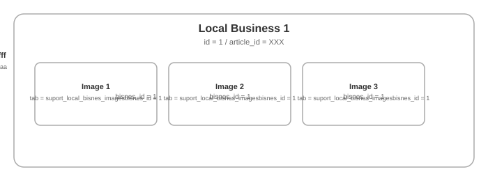

### Events

```
events (global)
└── locale_events (locale: title, description, dates)
```

Users can mark events as "interested" → stored in `interested_events` (the events favourite list; the daily reminder emails go to these users).

**Frontend (October 2026 redesign):**
- `items/cards/EventCardComponent.vue` — one card everywhere (events list, homepage block, "More upcoming events", user panel): photo with a tear-off date tag, category chip, status pill (starts in N days / tomorrow / today / happening now / finished), date range + time, short text (placeholder texts like "." hidden), interested heart + count. `external` prop = full guide URL in a new tab (user panel). Replaces `EventListCardComponent` (timeline) and `IndexEventCardComponent`.
- `services/guide/eventDates.js` — `event_status()`, `range_label()`, `has_time()` on real dates (the old cards compared day and month numbers separately and were wrong across months / years).
- `services/guide/interested.js` + `items/InterestedButtonComponent.vue` (`card` heart / `big` button with count) — one shared reactive set from `GET get_faworite/get_interested_event_ids`; counts are adjusted locally after a toggle; removing offers Undo; guests get the login / quick sign-up modal and the event is saved after sign-in.
- `pages/lists/EventsListPageComponent.vue` — the **timeline**: a central line with competitions on the left and festivals on the right (legend above), a hexagon marker (green and pulsing while happening, grey when finished) and a date flag pointing at the line for each event, and a label on the line for each group. On phones the line moves to the left and the flag sits above the card. All published events, filters in the URL (`when` upcoming / past / all, `cat` competition / event, `mine=1`, `q`); upcoming grouped "Happening now" + per month, past per year (newest first).
- `pages/pages/EventPageComponent.vue` — photo hero (category, dates, title, interested button with count, share), dates panel with add-to-calendar, text / info / map, sticky "At a glance" card, then up to three more upcoming events.
- User panel `/interested_events` — the same cards with Upcoming / Past tabs.

**API:** `get_event_on_site_list/{lang}` now returns **every** published event (past ones too) with `global_event.interested_count`; `get_event_on_index_page/{lang}` the next three that haven't finished (it used to compare month/day numbers and missed events ending next year); `get_event_on_site_page` 404s for unpublished events (they used to open by URL) and includes `interested_count`.

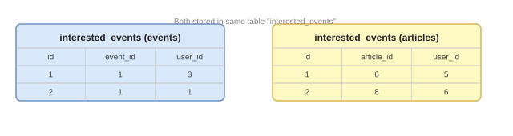

### Favorite Articles

Registered users can favourite **any guide article except news and special articles** (blog posts and films have their own favourites). Despite its name, `favorite_outdoor_areas` (`user_id`, `article_id`) holds all of them; allowed categories are `Favorite_outdoor_area::CATEGORIES` (outdoor, ice, indoor, mount_route, other, tech_tip, partners, spot_projects), checked when adding.

- **Heart** (`items/FavoriteHeartComponent.vue`): next to the title on outdoor / ice, mountaineering and every `ArticleComponent` page, and over the photo of every list card (outdoor, article, indoor, mountaineering, horizontal variants). One shared reactive set (`services/guide/favorites.js`) loaded with `GET get_faworite/get_favorite_article_ids`, so a page with many cards makes one request. Removing shows a toast with **Undo**.
- **"My favorites" strip** (`items/FavoriteArticlesStripComponent.vue`) at the top of the outdoor, ice, indoor, mountaineering and other lists, from `GET get_faworite/get_favorite_articles?lang=` (published only, newest first).
- User page `/my_favorite_outdoor_area` ("Favorite articles") lists all types with category filters.
- `DELETE set_faworite/del_favorite_outdoor_area/{article_id}` used to read `$request->article_id` (never set) and removed nothing — fixed to use the route parameter.
- Favourite-area update notifications (`ArticleResolver`) now cover every favourited type.

### Route reviews vs ascents

Ascent data no longer lives on reviews: when a climber ticks "I climbed it" in the review form, `RoutesReitingController::log_ascent_from_review()` creates a `route_ascents` row (style mapped: onsite → onsight, flash, second_go → redpoint with 2 attempts, redpoint, top_rope → toprope; skipped if the same climber + route + day is already logged) and the review is saved without `climbed_data` / `ascent_style`. Old reviews are moved once with `docs/BACKEND/sql-imports/2026_10_24_review_ascents_to_route_ascents.sql` (idempotent). Star ratings everywhere (route row, route / MTP modals, MTP block) are followed by the **ascent count** — `ascents_count` in `get_sector_and_routes` (grouped counts of `route_ascents` / `mtp_ascents`) and in the modal endpoints; `StarReitingShowComponent` takes it as `ascents_count_prop`.

---

## Admin Panel

Guide content is managed at `user.climbing.ge` under the **Guide** section.

| Admin Section | Manages |
|---|---|
| **Articles** | Create/edit/delete articles by category |
| **Sectors** | Add sectors to outdoor spots |
| **Routes** | Add climbing routes to sectors |
| **Multi-pitch** | Add MTP routes and pitches |
| **Route ascents** | All logged sport/boulder ascents (`/route_ascents`, `route › show`; delete needs `route › del`) |
| **Multi-pitch ascents** | All recorded MTP ascents (`/mtp_ascents`, `mtp › show`; delete needs `mtp › del`) |
| **Regions** | Outdoor climbing regions |
| **Mount Massifs** | Mountain group definitions |
| **Events** | Competitions and events |
| **General Info** | Reusable info blocks |
| **Sliders** | Hero image sliders |
| **Local Businesses** | Partner businesses |
| **Team Members** | Staff profiles |
| **Live Cameras** | Webcam embeds |
| **Comments** | Moderate user comments |
| **Gallery** | Manage images |

---

[Go back](../README.md)

### List search (outdoor, ice, indoor, mountaineering, other)

`items/ListSearchBarComponent.vue` + `services/guide/listSearch.js`, the same idea as the events page search: a search box with a "N found" count, kept in the URL (`?q=`, written after 300 ms). `search_items()` matches every typed word against the titles / names / short descriptions / `url_title` of an item in whatever shape the list API returns (case- and accent-insensitive). Ice, indoor and other filter their existing `filtered_*` list (grouping keeps working); outdoor and mountaineering show one flat result list (same cards, grid or list) while a search is typed, over what's loaded (all regions, or the chosen one). Each list's own `updateUrl()` keeps `q`, and its `$route` watcher returns early on `only_search_changed()` — typing doesn't refetch or scroll to the top.

### Find a route (area pages)

`items/climbing_routes/AreaRouteToolbarComponent.vue`: "N routes" / "Showing N of M" + Clear in the header, a search box (with ×) that matches route names **and grades** ("6b" → 6b and 6b+; `routeFilters.js` `route_matches`), the area's grade spread as a coloured bar (one clickable segment per band, sized by its routes) plus named band chips (Beginner ≤ 5c+, Intermediate 6a–6b+, Hard 6c–7a+, Expert 7b+, Projects), Classics / Hide climbed, and a "no routes match" line.

### Similar articles

`items/SimilarArticlesComponent.vue` lays `SimilarArticleCardComponent` / `SimilarOutdoorAreaCardComponent` out in a CSS grid (4 per row, 2 on tablets and phones — no longer hidden on phones); every card has a 4:3 photo frame (`object-fit: cover`), a two-line title and, for crags, sector / route count chips.
