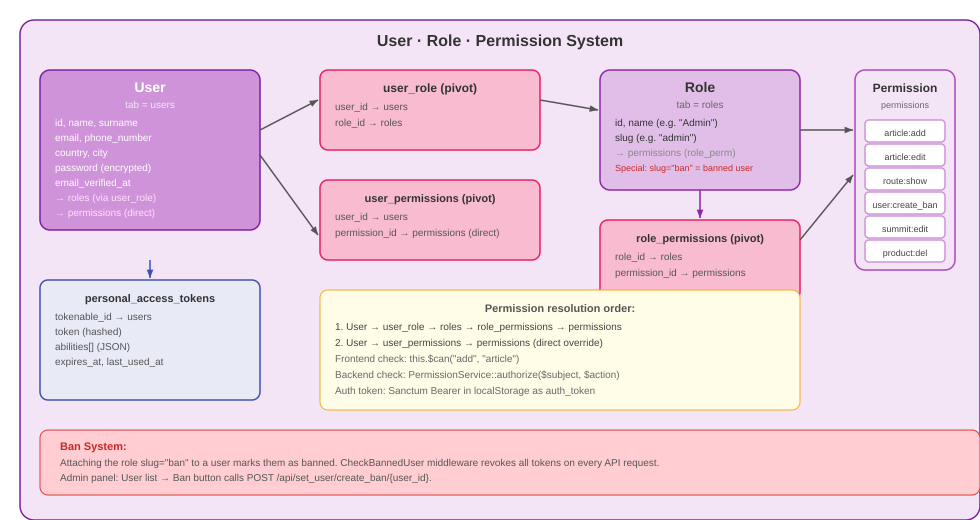
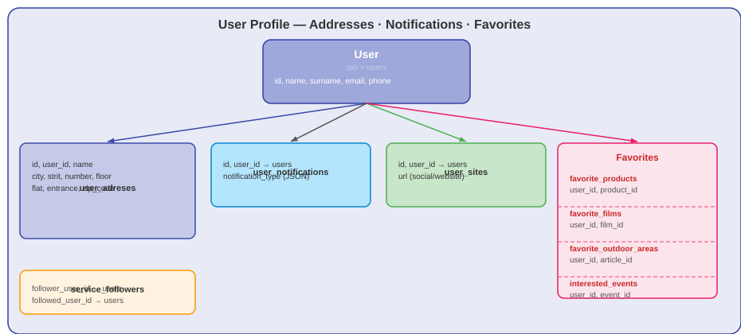
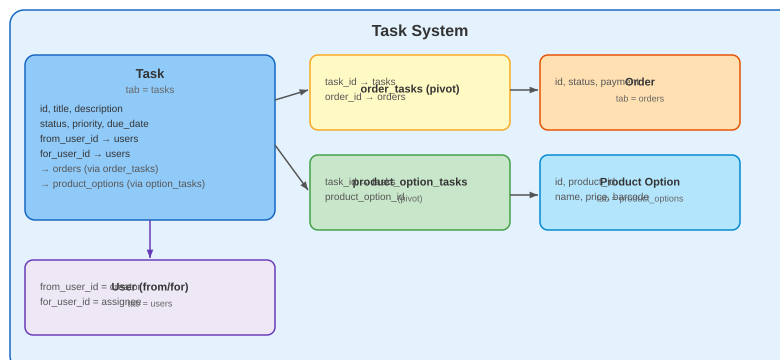

# User Dashboard & Admin CMS — user.climbing.ge

The unified user dashboard and content management system for all climbing.ge subdomains.

---

## Table of Contents

- [Overview](#overview)
- [Authentication Pages](#authentication-pages)
- [User Dashboard](#user-dashboard)
- [Admin CMS Sections](#admin-cms-sections)
- [Roles & Permissions](#roles--permissions)
- [Notifications & Queues](#notifications--queues)
- [Frontend Components](#frontend-components)
- [Backend API](#backend-api)
- [Page Meta Tags](#page-meta-tags)

---

## Overview

**Subdomain:** `user.climbing.ge`  
**Root Component:** `resources/js/components/user/HomeComponent.vue`  
**Router:** `resources/js/routes/UserRoutes.js`  
**API base URL:** Authenticated routes under `/api/`

The user panel serves two audiences:
- **Regular users** — profile, orders, favorites, tour reservations, notifications
- **Admin/staff users** — full CMS for all subdomains (guide, shop, blog, summit, films)

---

## Authentication Pages

All authentication UI lives in `resources/js/components/auth/`:

| Component | Route | Description |
|---|---|---|
| `LoginComponent.vue` | `/login` | Email + password login |
| `RegisterComponent.vue` | `/register` | New user registration |
| `Verify.vue` | `/verify` | Email verification prompt |
| `ForgotPassword.vue` | `/forgot-password` | Request reset link |
| `ResetPassword.vue` | `/reset-password` | Set new password with token |

See [AUTH.md](AUTH.md) for full authentication flow and API details.

---

## User Dashboard

After login, authenticated users access their personal dashboard.

### Home page (`pages/HomePageComponent.vue`)

Top to bottom, by priority:

1. **Hero** with quick actions (find a crag, logbook, find a partner, preferences).
2. **Staff work** — only with the permissions, so a plain user goes straight from the hero to their profile: **Needs attention** (`items/dashboards/AdminAttentionComponent.vue`), the locale-errors alert (`database › show`, only when there are errors), the mail card (`mail › show`).
3. **Your profile** — heading, climber card (points, followers, radar, "All users"), then `MyOverviewComponent.vue`: profile checklist (until complete) → **My climbing** stats → recent ascents / coming up.
4. **Getting around** — quick links, then the other climbing.ge sites (service tiles).

There is no account-alerts block on the home page any more: the profile checklist covers missing photo / location / bio…, and every alert is a badge in the menu (below). `items/notificatione/UserNotificationsListComponent.vue` is no longer used.

### Menu alert badges

`services/menuBadges.js` — one shared store, loaded by `AdminMenuTreeComponent.vue` (sidebar and mobile drawer), refreshed at most every 2 min, every 5 min while open, when the tab comes back, after login / permissions load and right after a profile save (`profile-updated` bus event from Options and the welcome-questions photo step). Background calls use `{ _silent: true }` (no error toast from `bootstrap.js`; a failing source just shows no badge).

| Badge | Where | Source |
|---|---|---|
| Account — red count on the avatar + "N to fix in your profile" (tooltip lists them) | sidebar user card (→ Options); also the top-bar bell count (`NavBadgesComponent`, same `account_alerts()`) | `auth_user`: e-mail not verified, name / surname missing, country / city missing, no date of birth, no photo |
| **Urgent** — orange | the menu link the "Needs attention" tile opens (`services/adminAttention.js`, shared with the dashboard) | comment complaints, user complaints, orders to ship, hazard reports, newly confirmed tour reservations; database relation issues (`set_admin_alerts/summary`, severity `danger`) |
| **New** — accent | All comments / All reviews / Summits … | `set_admin_alerts/summary` "info" alerts: new comments, product feedback, route / MTP reviews, summit ascents since you last looked. **Opening the page marks them seen** (`set_admin_alerts/mark_viewed`). |
| **Unread** — accent | Mail | `mail/unread_count` (`mail › show`) |
| **Urgent** / **New** | Gear rental | `set_gear_rental/summary` (`gear_rental › show`): overdue rentals (orange), due back today (accent) |

A badge only appears on a link the user may open (`can_open_route()`). A closed group shows the sum of its links instead of its page count (orange when anything inside is urgent). The top-bar menu button gets a dot (orange / accent) when anything has a badge — on desktop only while the sidebar is closed. Strings: `user.nav.account_alerts`, `user.nav.account_alert.*`, `user.nav.badge_urgent`, `user.nav.badge_new`.

**Layout rules** (every block spans the full content width, no Bootstrap `.container` inside the page): the 6 "My climbing" stats are 2 / 3 / 6 per row (< 768 / < 1200 / ≥ 1200 px) so a row is never half empty; the two overview cards are equal columns from 992 px, long route / event names are cut with an ellipsis; quick links use `auto-fit` (they stretch, no empty tracks); the 4 service tiles are 1 / 2 / 4 per row (never 3 + 1); the locale-errors summary is a full-width alert of its own (it renders nothing when all is fine) and the mail card sits below it full width (`.cg-dashboard__mail`), instead of the old `col-lg-6` pair that left half the row empty. The climber card keeps the "All users" link under the badges and the radar in its own column on the right (full-width, centred row below 768 px). 

The mail widget shows with `mail › show` (its "mail alerts" button only with `user_notification › show`); the locale-errors summary with `database › show` (its Fix buttons only with `database › edit`, its link only when the guide dashboard opens). The current user (`/auth_user`) is fetched through `services/authUser.js` → `get_auth_user()`: concurrent calls share one request and the answer is reused for 3 s for the same token (`{ force: true }` skips it: the notifications Refresh button, the cart's session check), so the route guard, navbar, nav badges, climber card, home page and notifications list make ~2 requests instead of ~6.

- `GET get_dashboard/get_my_overview` (`Api\User\DashboardOverviewController`): counts (route / MTP / summit ascents, routes this year, reviews, favourite articles and products, orders, open partner posts), the last 5 route ascents, up to 3 upcoming interested events, the last order, and a profile checklist (email verified, photo, bio, city/country, a link in the "Sites" list (`user_sites`), preferences, first ascent). The checklist card with a progress ring shows until everything is done; every number links to its page.
- `GET get_dashboard/get_admin_overview`: blocks, each only with the permission of its admin page — `guide` (`article › show`: unpublished articles, hazard/closure reports for `AreaConditionReport::WARNING_DAYS` (4, same as the public banner), condition reports 7 days, open partner posts), `moderation` (`comment › show`: comment complaints, open user complaints, new comments and reviews 7 days), `shop` (`order › show`: orders to ship = status Treatment / Preparation for shipment / Ready to ship / empty in the last 90 days, orders and revenue 7 days, back-in-stock subscribers waiting), `tours` (`tour_reservation › show`: confirmed in the last 7 days ("contact them", the urgent tile), waiting for email confirmation with check-in ahead, upcoming confirmed trips, new reservations 7 days, all linking to the reservations dashboard), `users` (`user › show`: total, new and active 7 days) — plus 30-day daily series (new users, logged ascents, comments, orders, tour reservations) drawn as sparklines. Tiles are **grouped by category** into cards: Moderation, Shop, Tour reservations, Guidebook, Users. Each card has an icon, a title and a badge: "N to handle" (orange) when its urgent tiles have work, otherwise a green "All clear". Cards with work waiting come first; the rest keep that order. Tiles with work waiting (complaints, orders to ship, hazards, newly confirmed tour reservations) are orange and sorted first inside their card. The cards sit in a grid (min 22rem) and stack on phones; with a single block (or one visible group) the card is full width. Each tile has **candidate pages, best first**, and links to the first one the user may open. This is because roles differ: an Order Manager has `order` but not `shop_task`, so "Orders / Revenue (7 days)" link to All orders instead of the Shop dashboard. An Article Manager has `article` but not `guide_task`, so "Unpublished articles" links to the article list of the category with the most drafts (`blocks.guide_meta.draft_category`). An urgent tile counts toward "N to handle" (and turns orange) only when the user can open it. A tile links to its page only when the user may open that route (`services/ability/canOpen.js` → `can_open_route()`: the route's `meta.permissions`, same rule as the guard in `app.js`); otherwise it shows just the number, e.g. a Content Moderator (`comment › show`) sees "User complaints" without a link to the Users list (`user › show`). The same component, filtered with `:blocks`, sits at the top of the shop dashboard (`['shop', 'tours']`; this replaces the separate tour-reservations card) and the guide dashboard content tab (`['guide', 'moderation']`).
- Guide dashboard → **Community** tab (`comment › show`, `dashboards/guide/assets/CommunityModerationComponent.vue`): condition reports and partner posts with Hide / Show (`set_area_report/get_area_reports_admin`, `set_partner_post/get_partner_posts_admin`; toggling needs `comment › del`).

### Preferences & welcome questions

Account defaults on `users`: `lang` (`us`/`ka`), `grade` (`yds`/`uiaa`), `mount_grade` (`russian`/`french`, which alpine scale is shown first — `formatMountGrade()`), `animations` (bool), `onboarded_at` (migration `2026_10_24_140000_add_preferences_to_users_table.php`), `use_offline_data_on_mobile` (bool, default `false`; set only from the training mobile app — no web UI; migration `2026_11_12_120000_add_use_offline_data_on_mobile_to_users_table.php`).

- Options page → **Preferences** tab (`items/preferences/UserPreferencesComponent.vue` + shared `PreferenceFieldsComponent.vue`).
- **Quick sign-up**: the global login modal (`LoginModalComponent.vue`, mounted on every public site) has *Log in / Sign up* tabs; it always opens on *Log in*. Sign-up asks the same fields as the full register page: name, surname, email, country, city, phone, password (strength bar) + confirmation, and one terms + privacy checkbox (links to the guide's legal pages). It posts to `register` (reCAPTCHA as before). `country`, `city` and `phone_number` stay optional in `RegisterController` for social sign-up. Open it with `$bus.$emit('open-register-modal', { callback, reason })` (`reason` shows a short note on top) or `open-login-modal`.
- `user/user_image_update/{user_id}` now only accepts your own id (it used to let any logged-in user replace anyone's photo).
- **Welcome questions** (`items/preferences/WelcomeQuestionsComponent.vue`, mounted in the user shell `HomeComponent.vue`, and with `public_site` in every public site root where it opens only right after the quick sign-up — `sessionStorage.cg_just_registered`): shown while `onboarded_at` is null. Step 1 profile photo (square-cropped to 600px JPEG in the browser, uploaded to `user/user_image_update/{id}`), step 2 "What are you into?" (outdoor, gyms, ice, mountaineering, shop, tours, blog, films → switches **on** the matching "new content" email notifications, never off), step 3 the defaults above. *Skip* only sets `onboarded_at`.
- API (`get_options`): `GET get_preferences`, `POST update_preferences` (`lang`, `grade`, `mount_grade`, `animations`, `use_offline_data_on_mobile`, `interests[]`, `onboarded`) — every field optional, only sent fields change; answers with the same shape as `get_preferences`.
- Applying: `services/preferences.js` runs after every `auth_user` fetch (`store/auth.js`) but only when the saved defaults differ from what this device last applied (`localStorage.cg_prefs_applied`), so later changes with the navbar switches stick on that device. It sets `grade` / `mount_grade` in localStorage (reloads once), the animation switch, and moves to/from the `/ka` URL for the language.

### Profile & Settings

Page `/options` (`pages/optionsPageComponent.vue`): `cg-page-head` hero (`cg-art-user`) + a `cg-segmented` tab bar — **Profile · Addresses · Notifications · Preferences**. The open tab is kept in `?tab=` (`addresses`, `notifications`, `preferences`; no query = profile), so it survives reloads and can be linked to. On phones the tab bar shows icons only.

Profile tab (`items/user_options/UserOptionsComponent.vue`):
- **Alerts on top**: a yellow *Add your date of birth* call-out when `birthday` is empty (button opens the edit modal focused on the date field), and a blue *incomplete* call-out listing the other missing fields (name, surname, phone, email, country, city).
- **Identity card**: avatar (click to change; initials when there is no photo), name, email, verified / age badges, a profile-completeness bar (all personal fields except language), *change photo* and *change password* buttons.
- **Personal information**: a field grid; empty fields show "Not set" (birthday: "No date of birth") as a link that opens the edit modal on that field. Birthday shows as a localized date + age.
- **My sites & social links** (`user_sites`): cards with a brand icon (Instagram, Facebook, YouTube…), open in a new tab, edit / delete icon buttons, empty state.
- **Danger zone** panel with the *Delete my account* link.
- Edit modal: labelled two-column form; name, surname, email and date of birth are required; validation errors (422) show under the field; a toast confirms the save.
- API: `POST /api/get_options/user_info_update/:user_id`

### Delivery Addresses

CRUD for saved delivery addresses used in shop checkout. One address per user can be marked default (`is_default`) — it's used to auto-select an address and preview shipping cost on the cart/checkout pages.

- API: `GET /api/get_user_adreses`, `POST /api/add_user_adreses`, `POST /api/edit_adres/:id`, `POST /api/set_default_adres/:id`, `DELETE /api/del_user_adreses/:id`

### Orders

View past shop orders, order status, and download receipts.

### Favorites

- Favorite articles of every guide type except news and special articles (`/my_favorite_outdoor_area`, filter by category) — see [GUIDBOOK.md](GUIDBOOK.md#favorite-articles)
- Interested events
- Favorite films

### Users: add user, birthday, age

- **Users list → "Add user"** (`user › add`, `UserAddModalComponent`, `POST set_user/create_user`):
  - fields: name, surname, email, password (generate / show), date of birth (with live age), phone, country, city, role (default User; giving admin needs `role › edit`), "Email is confirmed"
  - validation errors show under each field
- **`users.birthday`** (migration `2026_11_12_110000_add_birthday_to_users.php`):
  - **required at registration** — `POST /api/register` validates `required|date|before:today|after:1900-01-01`; both web sign-up forms (login-modal quick sign-up and the `/register` page) ask for it. The mobile app must send it too, or sign-up returns 422
  - user panel **Options** page shows the date of birth + age, or "No date of birth" plus an *Add your date of birth* alert (see *Profile & Settings*). `get_options/user_info_update` saves it when non-empty; an empty value keeps the stored one
  - admin: Users table **Age** column (Carbon age); user info modal (eye) → Overview → Profile shows date of birth + age (`AdminUserOverviewService::profile`); user manage modal → Profile tab edits it (`update_user_info`, nullable)

### Tour Reservations

View and manage tour bookings placed through the shop. Admins (`tour_reservation › show`) open them from the **Shop dashboard** menu group: a [dashboard](FUNCTIONS_DOCS/shop/tour_reservations_dashboard.md) (stats, calendar, month chart, top tours) above the reservations table. Every booking is confirmed from an emailed link ([verification](FUNCTIONS_DOCS/shop/tour_reservation_verification.md)), and the price comes from the tour's [price list](FUNCTIONS_DOCS/shop/tour_price_calculator.md) and [season](FUNCTIONS_DOCS/shop/tour_schedule.md).

---

## Admin CMS Sections

Admin users with appropriate roles see additional sections in the left menu.

### Guide Admin

Manage all content for `climbing.ge`:

| Section | What You Can Manage |
|---|---|
| **Articles** | Mount routes, outdoor spots, ice climbing, indoor, events, projects |
| **Sectors** | Sector data, images, local images for climbing spots |
| **Routes** | Climbing routes, grades, bolt counts, sector assignment, route topos |
| **Multi-pitch** | Multi-pitch route pitches |
| **Regions** | Outdoor climbing regions |
| **Mount Massifs** | Mountain massif groups |
| **Events** | Climbing competitions and events (two tabs; finished rows grey, running-now rows accent — [row marks](FRONTEND/USER_PANEL_TABLE.md#row-marks-row-colors)) |
| **General Info** | Reusable info blocks (contacts, warnings) |
| **SEO dashboard** | Search Console clicks / impressions / positions per page, opportunities (almost page 1, low CTR, losing traffic), content quality list — `seo › show`; see [FUNCTIONS_DOCS/user/seo_dashboard.md](FUNCTIONS_DOCS/user/seo_dashboard.md) |
| **Sliders** | Hero image sliders per section |
| **Local Businesses** | Partner businesses linked to climbing areas |
| **Team Members** | Team/staff profiles |
| **Live Cameras** | Live webcam embeds |

### Shop Admin

Manage all content for `shop.climbing.ge`:

| Section | What You Can Manage |
|---|---|
| **Products** | Product catalogue with locale data, images, options |
| **Categories / Subcategories** | Product taxonomy |
| **Brands** | Product brands |
| **Orders** | Customer orders, status updates |
| **Custom Orders** | Manual/special orders |
| **Tours** | Multi-day guided tours — edit page tabs: Global info, English, Georgian, **Prices** (calculator rules, EUR), **Season & duration** (periods, durations, start days, lead time, max group) |
| **Tour Categories** | Tour taxonomy |
| **Reservations** | Tour bookings — moved to the Shop dashboard group (see above) |
| **Services** | Additional services offered |
| **Warehouses** | Inventory tracking |
| **Sale Codes** | Discount codes |
| **Shipping Regions** | Shipping zones + prices |

### Summit Admin

Manage all content for `summit.climbing.ge`:

| Section | What You Can Manage |
|---|---|
| **Summits** | Summit database — title, height, coordinates, QR code, publish status |
| **Ascents** | All ascent records across all summits |

See [SUMMIT.md](SUMMIT.md) for full summit admin documentation.

### Training Admin

Content management for the companion **climbing training mobile app** (fingerboard/campus/flexibility/strength/endurance workouts and multi-day coaching plans) — this repo is the CMS + public JSON API the app points at, there is no dedicated public subdomain for it.

| Section | What You Can Manage |
|---|---|
| **Trainings** | Individual exercises/workouts — global info incl. cover image, step-by-step breakdown, Georgian translation, compatible shop products |
| **Training Plans** | Multi-day coaching programs — global info, per-day sessions (which trainings run on which day), Georgian translation |

Left-menu visibility gated on `training`/`training_plan` `show` permission; a dedicated `training_creator` role exists for a trusted non-admin to manage content (`show`/`add`/`edit`, no `del`). Full detail: [TRAINING.md](TRAINING.md).

### Blog Admin

Create, edit, publish, and delete blog posts and news articles. Uses Quill rich-text editor.

### Films Admin

Manage film catalogue: add/edit/delete films, categories, and tags.

### User Management

Manage registered users:
- View all users, search, filter by role
- Edit user roles and permissions
- Ban/unban users (attaches/detaches the `ban` role) — reversible, keeps the account and its data
- **Permanently delete a user** — `DELETE /api/set_user/del_user/{user_id}` (requires `user:del`, added alongside the August 2026 registration fixes). Distinct from banning: this removes the `User_role`, `user_notification`, and `User_permission` rows and the account's uploaded image, then deletes the `User` row itself. An admin cannot delete their own account this way (`bulk_delete` has the same self-protection, filtering the acting admin's own id out of the `ids` array before deleting). Not reversible — no soft-delete.
- Reset user passwords

### Tasks

Internal task/todo system for staff. Tasks can be assigned to users with due dates, and organised by task categories.

### Multimedia Manager

Browse, upload, and delete images across all subdomains. The file tree shows which images are in use and which are orphaned.

### Database

View all database tables with row counts and detected integrity issues. Apply fixes directly from the UI.

### Notification Analytics

Charts and tables covering notification volume over time, breakdown by notification type and content type, per-preference adoption, and recent send activity. See [NOTIFICATIONS.md](NOTIFICATIONS.md).

### Coefficients

**Site Options → Coefficients** (`/coefficients`, permission `coefficient › show/add/edit/del`). A table of slug / value / description with add and edit modals. It controls the climbing wall calculator prices, shop delivery periods, and climber points weights. Changes apply on the next page load. Full guide: [COEFFICIENTS.md](COEFFICIENTS.md).

### Export

`/export_tips` (`export › show`, `pages/expoet/exportComponent.vue`): pick a category (chips), search / "only published", tick articles (titles in the site language, region, sector count, last update), then download:

- **PDF** — the existing `set_export/articles_pdf` (language ka / us / both, optionally sectors + routes for outdoor / ice).
- **Articles CSV** — `POST set_export/articles_csv`: one row per article (id, category, EN / KA titles, public URL, published, region, sector / route / multi-pitch counts, dates).
- **Routes CSV** — `POST set_export/routes_csv` (outdoor / ice): every route and multi-pitch pitch with area, sector (+ published), number, name, type, grade, alternative grade, bolts, height, author, first ascent.

CSV files are UTF-8 with a BOM so Excel shows Georgian correctly. The last category, format, language and options are remembered in `localStorage` (`cg_export_settings`). The old `ExportArticlesModalComponent.vue` was removed.

---

## Roles & Permissions

### Backend (Custom Role/Permission Tables)

Roles and permissions stored in custom `roles`, `permissions`, `user_role`, `user_permissions`, `role_permissions` tables (not Spatie).




**Default roles:**

| Role | Description |
|---|---|
| `admin` | Full CMS access |
| `ban` | System role — having this role means the user is banned |
| `guide` | Shop tours management |
| `user` | Standard authenticated user |

**Permission columns:** `subject` + `action` (stored separately).  
Examples: `subject='article', action='add'` | `subject='summit', action='edit'` | `subject='user', action='create_ban'`

Use the **Sync Admin Permissions** button to assign all existing permissions to the admin role at once.

### User Profile, Addresses & Favorites



### Task System



### Frontend (CASL Vue)

Abilities are synced from `/api/auth_user` response on login.

```javascript
// Usage in templates
<button v-if="$can('add', 'summit')">Add Summit</button>
<router-link v-if="$can('edit', 'article')" :to="...">Edit</router-link>

// Usage in JavaScript
if (this.$ability.can('del', 'product')) { ... }
```

See [AUTH.md](AUTH.md) for full CASL setup.

---

## Notifications & Queues

### Email Queue

The platform uses Laravel Queues for sending bulk emails (event notifications, newsletter, etc.).

Queue configuration in `.env`:
```env
QUEUE_CONNECTION=database
```

Run queue worker:
```bash
php artisan queue:work                    # runs indefinitely
php artisan queue:work --queue=emails     # emails queue only
php artisan queue:work --timeout=60       # restart every 60s
php artisan horizon                       # Horizon dashboard
```

### Scheduled Notifications

Laravel Task Scheduling runs the event-reminder command daily.

```bash
php artisan schedule:work          # run scheduler locally
php artisan schedule:list          # list all scheduled tasks
php artisan send_event_notificatione:users  # run manually
```

Scheduler defined in `app/Console/Kernel.php`. Notification job: `app/Jobs/UserNotifications.php`.

Timezone: `Asia/Tbilisi` — set in `config/app.php`.

### User Notification Preferences

Each user has a `user_notifications` record (JSON preference blob) controlling which email types they receive. Managed at: `GET/POST /api/get_options/get_user_notification_data` and `/api/get_options/update_user_notification_data`.

### Automatic New-Content Notifications

Publishing new content in the guide, shop, blog, summit, or films domains automatically emails subscribed users — no admin action required. Sends are deduplicated via `content_notification_logs` so nothing is ever emailed twice. See [NOTIFICATIONS.md](NOTIFICATIONS.md) for the full architecture (resolvers, observers, dedup log, the analytics dashboard).

---

## Frontend Components

### Layout Components (`resources/js/components/user/items/`)

| Component | Description |
|---|---|
| `BreadcrumbComponent.vue` | Breadcrumb navigation bar |
| `LeftMenuComponent.vue` | Left sidebar navigation |
| `NavbarComponent.vue` | Top navigation bar |
| `FooterComponent.vue` | Footer |

### Data Table System (`items/data_table/`)

The admin panel uses a generic tabbed data table system. See [FRONTEND/USER_PANEL_TABLE.md](FRONTEND/USER_PANEL_TABLE.md) for full documentation.

**Components:**
- `TabsComponent.vue` — Main wrapper with tabs, search, pagination
- `TabHeaderComponent.vue` — Table `<thead>` renderer
- `TabBodyComponent.vue` — Table `<tbody>` with action buttons
- `DataComponent.vue` — Cell value renderer (supports bool icons, nested fields)
- `FilterComponent.vue` — Dropdown filter
- `PaginationComponent.vue` — Page navigation
- `SearchComponent.vue` — Text search

### Modals (`items/modal/`)

| Component | Description |
|---|---|
| `StackModal.vue` | Generic reusable modal (see FRONTEND/STACK_MODAL.md) |
| `ArticleQuickViewModal.vue` | Quick preview for guide articles |
| `tab_modals/SectorModalComponent.vue` | Sector route management |
| `tab_modals/ArticleSectorSequenceModalComponent.vue` | Sector ordering |

### Form Editors (`items/form/parts/editor/`)

Three globally registered Quill-based rich text editors:

| Name | Component | Use |
|---|---|---|
| `big_editor` | `BigEditorComponent.vue` | Full-featured: text, images, tables |
| `small_editor` | `SmallEditorComponent.vue` | Basic text formatting |
| `mini_editor` | `MiniEditorComponent.vue` | Single-line rich text |

---

## Backend API

### User Data Routes (`routes/api/get_user_routes.php`)

All routes behind `auth:sanctum` + `banned` middleware.

**User:**

| Method | Path | Description |
|---|---|---|
| GET | `/api/auth_user` | Current user + abilities |
| GET | `/api/get_user/get_auth_user_data` | Detailed user data |
| GET | `/api/get_user/get_user_data/:user_id` | Another user's data (admin lookup) |
| GET | `/api/get_user/get_all_users` | All users (admin) |
| GET | `/api/get_user/get_worker_users` | Users with a staff-capable role, for assignment dropdowns (e.g. task assignee) |
| GET | `/api/get_user/get_auth_user_permissions` | User's permissions array |
| GET | `/api/get_user/post_user/:user_id` | *(controller method `get_post_user` — route path doesn't match the method name)* |
| GET | `/api/get_user/get_team/get_member_status/:id` / `get_team_members` | Team-member lookups scoped under the authenticated-user namespace, distinct from the public guide team endpoints |
| POST | `/api/user/user_image_update/:user_id` | Upload/replace avatar |
| POST | `/api/user/update_password` | Change own password |
| GET/POST/PUT/DELETE | `/api/user_site` (`Route::apiResource`) | CRUD for the profile's external links list (`user_sites` table, `id`+`url`+`user_id`) — the `user_sites` shown on the public [Climber Profile](CLIMBER_PROFILE.md#backend-api) |
| GET | `/api/get_options/get_selected_user_data/:user_id` | Admin: load one user's editable profile data |
| GET | `/api/get_options/get_user_notification_data` | Current user's notification-preference blob |
| POST | `/api/get_options/user_info_update/:user_id` | Update profile |
| POST | `/api/get_options/update_user_notification_data` | Update notifications |

**Addresses:**

| Method | Path | Description |
|---|---|---|
| GET | `/api/get_user_adreses` | All saved addresses for the current user, including `is_default` |
| GET | `/api/get_activ_adres/:id` | Fetch one specific address by id (used by checkout once an address is selected — despite the name, this does *not* return "the default one"; use `is_default` from `get_user_adreses` for that) |
| POST | `/api/get_editing_adres/:id` | Load one address for editing (POST despite being a read, per this controller's existing convention) |
| POST | `/api/add_user_adreses` | Add address. `adding_data.is_default: true` (or being the user's first address) makes it the new default and demotes any other default the user had |
| POST | `/api/edit_adres/:id` | Edit address. Include `is_default` in `data` to change which address is default |
| POST | `/api/set_default_adres/:id` | Mark one existing address as the user's default, demoting all others |
| DELETE | `/api/del_user_adreses/:id` | Delete address |

All five id-scoped endpoints (`get_activ_adres`, `get_editing_adres`, `edit_adres`, `set_default_adres`, `del_user_adreses`) are scoped to `user_id = auth user` server-side — an id belonging to another user resolves to "not found" rather than exposing/mutating their address. `User_adreses.map` (an optional Google Maps link/coordinates field, shown as `quick_adres.map` in checkout) has a real migrated column — a prior version of `add_user_adreses` set this attribute without the column existing, which made every address-add request fail with a SQL error.

A user always has exactly one `is_default` address, used to preview shipping cost/minimum-order-price/free-shipping messaging on the cart page and to pre-select an address on the checkout payment step (see [SHOP.md](SHOP.md#shipping-regions--checkout-shipping-rules)).

**Favorites:**

| Method | Path | Description |
|---|---|---|
| GET | `/api/get_faworite/get_faworite_outdoor_region` | Favorite areas |
| GET | `/api/get_faworite/get_interested_events` | Interested events |
| GET | `/api/get_faworite/check_interested_status/:event_id` | Is the current user interested in this event? |
| GET | `/api/get_faworite/check_favorite_status/:article_id` | Has the current user favorited this outdoor area? |
| POST | `/api/set_faworite_by_user/add_to_favorite_outdoor_area/:id` | Add favorite |
| POST | `/api/set_faworite_by_user/add_to_interested_events` | Mark interested in an event |
| DELETE | `/api/set_faworite/del_favorite_outdoor_area/:id` | Remove favorite |
| DELETE | `/api/set_faworite/del_interested_event/:id` | Remove interest |

**Climber follow (climber-to-climber, not the legacy shop/guide "service following"):**

| Method | Path | Description |
|---|---|---|
| POST | `/api/set_user_follow/follow/{user_id}` | Follow another climber |
| DELETE | `/api/set_user_follow/unfollow/{user_id}` | Unfollow |
| GET | `/api/set_user_follow/follow_status/{user_id}` | `{ following, is_self }` |

Full writeup — social graph, activity-email notifications, and the two other similarly-named-but-unrelated "follow" models this can be confused with — in [CLIMBER_PROFILE.md](CLIMBER_PROFILE.md#the-follow-system).

---

## Page Meta Tags

Every user.climbing.ge page has its own `<title>`, description, Open Graph / Twitter tags and canonical link — same approach as the public sites (`SeoService` server-side + `@unhead/vue` client-side), but **always `noindex, nofollow`** since it's a private dashboard.

| Layer | Where | What it does |
|---|---|---|
| Titles (one list for both layers) | `resources/lang/i18n/{en,ka}.json` → `user.meta` | `titles.<route name>` for every route in `UserRoutes.js`, plus `site_name`, `default_title`, `default_description` |
| Server (first load, link previews) | `SeoService::forUser()` ← `User\IndexController` → `partials/seo.blade.php` in `user/layouts/app.blade.php` | Matches the URL against the route table parsed from `UserRoutes.js` (cached until the file changes), takes the title from `user.meta.titles` in the URL's locale (`/ka/...` → Georgian) |
| Client (SPA navigation) | `router.afterEach` in `resources/js/app.js` | Same title/description/OG tags on every navigation and on language switch |
| Per-page override | `components/user/items/MetaDataComponent.vue` | Optional — for record-specific titles (e.g. "Edit: <product name>"); wins over the route title |

Title format: `<Page title> | user.climbing.ge` (unknown routes: `default_title`). `partials/seo.blade.php` takes `robots` from `$seo['robots']` (default `index, follow`) and skips the sitewide Organization/WebSite JSON-LD on noindex pages.

**Adding a page:** add the route to `UserRoutes.js` with a `name` and an English `meta.title`, then add `user.meta.titles.<name>` to both `en.json` and `ka.json`. Nothing else — the server picks the route up automatically. Without a translation the English `meta.title` is used on the client and `default_title` on the server.

---

[Go back](../README.md)
